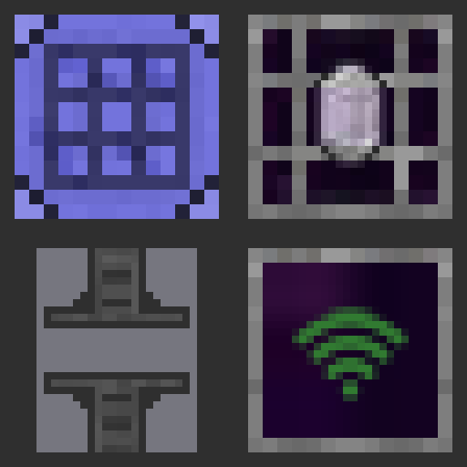

<p align="center"></p>

# AE2 Stuff Reforged

[Русский](README.ru.md)

A port of [AE2 Stuff](https://github.com/bdew-minecraft/ae2stuff) by bdew to Minecraft 1.16.5 and Applied Energistics 2 8.x.
It is ported from the original `mc1.12` code (version 0.7.0) and aims to behave the same.
The original was written in Scala on top of bdlib, the port is plain Java and needs nothing but Forge and AE2.

| | Version |
| --- | --- |
| Minecraft | 1.16.5 |
| Forge | 36.1.10 or newer, tested on 36.2.42 |
| Applied Energistics 2 | 8.4.7 or newer 8.x, tested on 8.4.7 |
| JEI | optional, tested on 7.7.1.153 and 7.8.1.1018 |
| Hwyla | optional, tested on 1.10.11-B78_1.16.2 |

Install it on both the client and the server.

## Content

| | What it does |
| --- | --- |
| Pattern Encoder | Encodes crafting patterns from a 3x3 grid. Opens only while connected to a powered ME network. Fill the grid by hand or with the JEI "+" button, which picks the ingredient variants that are in your ME storage. Drop an encoded pattern on the blank pattern slot to recycle it. |
| Crystal Growth Chamber | Grows AE2 crystal seeds and turns charged certus quartz, redstone and nether quartz into fluix crystals. Takes up to 3 speed cards. |
| Advanced Inscriber | Runs inscriber recipes with up to 5 speed cards. The press slots can be locked so automation never takes the presses out. |
| Wireless Connector | Connects two points of an ME network without cables, with dense cable capacity. Uses 10 + distance² AE/t. |
| Wireless Setup Kit | Click two connectors to link them. Sneak and use in the air to clear it. Respects network security. |
| Network Visualisation Tool | Click any ME block to bind it, then see the network's nodes, links and channel counts through walls. Sneak and scroll to switch the mode. |

Machines take power from the ME network, keep their inventory, upgrades and power when broken, and show the AE2 network tool toolbox in their GUI.
They work with anything that uses the standard item handler: hoppers, AE2 interfaces and buses, and pipe mods.
Tested with Mekanism logistical transporters and Pretty Pipes.

The settings are in `config/ae2stuff-common.toml`. Recipes are regular JSON recipes and can be changed with a data pack.

## Differences from the 1.12 version

Forced by Minecraft and Forge:

- `tuning.cfg` became `config/ae2stuff-common.toml` with the same options and defaults.
- `recipes.cfg` became JSON recipes, override them with a data pack.
- Tool bindings store the dimension by name.
- Waila support targets Hwyla, so Jade works as well.

Forced by AE2 8.x:

- Crafting patterns now reference the recipe id, the Encoder writes them through the AE2 API.
- Inscriber recipes moved into the vanilla recipe system.
- AE2 seeds are three separate items now, any growable crystal is accepted.
- The upgrade and toolbox panels are drawn from AE2's new `extra_panels.png`.
- AE2 wrenches no longer rotate or dismantle foreign blocks by themselves, the mod handles both for its machines.

Kept on purpose, because the original behaves this way:

- A machine broken by a network security violation drops itself but not its inventory.
- The Advanced Inscriber is strict about which press goes on top and which at the bottom, and does not take name presses.
- An unlocked press can only be taken out by automation while a job is running, although the tooltip says otherwise.
- If one end of a wireless link is unloaded, the other keeps showing the link and drawing power until it loads again.
- A machine with an empty power buffer can take up to 100 ticks to start.

## Building

Needs JDK 8.

```
JAVA_HOME=/path/to/jdk8 ./gradlew build
```

The mod jar ends up in `build/libs/`. `runClient` and `runServer` start a development instance.

## Credits and license

AE2 Stuff was created by bdew. This port is by demonyga.
MIT, see [LICENSE.txt](LICENSE.txt). AE2 textures are not included, they are read from AE2 at runtime.
